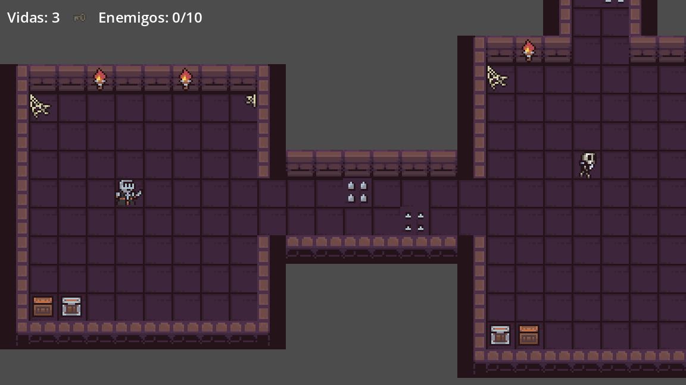

# Dungeon Escape

Juego de acción 2D con vista cenital, hecho en **Godot 4.7.2**. El jugador controla a un caballero que debe recorrer un calabozo de 7 salas, conseguir la llave que custodia una parca y llegar a la puerta de salida.



**Descarga:** los ejecutables para Windows y Linux están en [Releases](https://github.com/Thegreenmarshadow/dungeon-escape/releases/latest).

## Cómo jugar

| Acción | Teclas |
|---|---|
| Moverse (8 direcciones) | Flechas o W A S D |
| Atacar con la espada | Espacio o J |
| Reiniciar (en las pantallas finales) | R |

**Objetivo:** encontrar la llave y llegar a la puerta de salida, en el extremo opuesto del mapa.

- El jugador tiene **3 vidas** y medio segundo de invulnerabilidad después de recibir daño.
- Las **trampas de picos** hacen daño solo cuando los picos están levantados.
- Enemigos:

| Enemigo | Vida | Comportamiento |
|---|---|---|
| Esqueleto | 2 golpes | Patrulla entre dos puntos; si el jugador se acerca a su ruta, va hacia él y ataca con una estocada anunciada. Al recibir un golpe retrocede y tarda en volver a atacar |
| Vampiro | 3 golpes | Persigue al jugador a menos de 80 px y vuelve a su puesto si lo pierde |
| Parca (jefe) | 5 golpes | Lenta; protege la sala de la llave |

- **Esquiva:** cada enemigo puede esquivar un golpe (esqueleto 15 %, calavera 10 %, vampiro 20 %, parca 10 %): no recibe daño, da un paso atrás y aparece «¡Esquiva!». Nunca esquiva dos golpes seguidos (1 s de espera), ni mientras ataca o embiste.
- La vida de la tabla es la del nivel 1. Cada nivel suma un **8 % de la vida base** (×1.08 en el nivel 2, ×1.72 en el 10, ×8.92 en el 100; se redondea): un esqueleto aguanta 3 golpes en el nivel 10 y 18 en el 100. El daño que hacen los enemigos no cambia.

- **Monedas:** los enemigos pueden soltar monedas al morir (los más duros, más seguido y de más valor; la parca, casi siempre) y en cada mapa generado hay una suelta. Valen más cuanto más alto el nivel: se multiplican por la misma escala que la vida de los enemigos. Se conservan entre niveles y se reinician en cada partida.
- **Tienda:** en la pantalla de nivel superado se pueden gastar las monedas en **+1 daño** (10, 20, 30... hasta 100 monedas; hasta 10 veces por partida) o **+1 vida** (6 monedas en el nivel 1, multiplicadas por la escala del nivel; solo si falta alguna). Así las mejoras de daño siguen el ritmo de la vida de los enemigos.
- La interfaz muestra las vidas, si se tiene la llave, cuántos enemigos se eliminaron y las monedas. La pantalla de victoria incluye ese contador.

## Cómo ejecutarlo

### Opción 1: ejecutable (sin instalar Godot)

Descargar el archivo de la plataforma desde [Releases](https://github.com/Thegreenmarshadow/dungeon-escape/releases/latest) y ejecutarlo:

- **Windows:** descomprimir `dungeon-escape-windows.zip` y abrir `dungeon-escape.exe`. Si Windows SmartScreen muestra un aviso (el ejecutable no está firmado), elegir **Más información → Ejecutar de todas formas**.
- **Linux:** descomprimir `dungeon-escape-linux.tar.gz` y ejecutar `./dungeon-escape.x86_64` (si no arranca, darle permiso con `chmod +x dungeon-escape.x86_64`).

### Opción 2: abrir el proyecto en Godot

1. Instalar **Godot 4.7.2** (versión estándar, no .NET).
2. En el gestor de proyectos: **Importar** → seleccionar el archivo `project.godot`.
3. Presionar **F5** (o el botón ▶) para jugar. La escena principal es `scenes/Level.tscn`.

## Estadísticas, ranking y servidor local

El juego registra cada partida (tiempo, niveles, enemigos eliminados, daño recibido, llaves y corazones recogidos, muerte o abandono) y la envía a un servidor local que la guarda en SQLite. El mismo servidor tiene una interfaz web para consultar los datos.

```text
Godot --HTTP/JSON--> FastAPI (127.0.0.1:8765) --> SQLite (server/data/game.db)
                      └── interfaz web en http://127.0.0.1:8765/
```

**El servidor es opcional.** Si no está encendido el juego funciona igual: guarda lo pendiente en `user://stats_queue.json` (hasta 1000 pedidos; pasado ese tope descarta los más viejos) y lo envía cuando el servidor vuelve a responder, con reintentos cada 2 s que se duplican hasta 60 s. El menú muestra el ranking del servidor ("Fuente: en línea") o, si no responde, la tabla local de siempre ("Fuente: local").

### Encender el servidor

Requiere [uv](https://docs.astral.sh/uv/) (instala Python 3.13 y las dependencias la primera vez):

```bash
cd server
uv run game-stats            # http://127.0.0.1:8765  (--port, --db, --reload)
```

Luego abrir <http://127.0.0.1:8765/> para ver el ranking, el historial de partidas (filtrable por jugador y modo), el detalle de cada partida con sus eventos y las estadísticas globales. La base se crea sola al arrancar con `server/schema.sql`.

Otros comandos (desde `server/`):

| Comando | Qué hace |
|---|---|
| `uv run pytest` | Pruebas del servidor (usan una base temporal) |
| `uv run game-stats-seed` | Agrega partidas de ejemplo (ids `seed-…`) |
| `uv run game-stats-seed --remove` | Quita las partidas de ejemplo |

Para empezar de cero basta con borrar `server/data/`.

### Qué se guarda

- `players`: nombre del jugador (se escribe en el menú principal; por defecto "Jugador").
- `runs`: una fila por partida, con modo (`normal` o `test`), semilla, nivel inicial y alcanzado, puntos, enemigos, duración y resultado (`died`, `quit` o `in_progress`).
- `events`: la línea de tiempo de cada partida. Acepta cualquier tipo de evento, así se pueden sumar otros sin cambiar la base. Tipos actuales: `level_started`, `enemy_killed`, `damage_taken`, `heart_picked`, `key_picked`, `coin_picked`, `item_bought`, `level_completed`, `player_died` y `run_quit`.

El ranking solo incluye partidas terminadas en modo normal; las del modo prueba se guardan pero no compiten.

API principal: `POST /api/players`, `POST /api/runs`, `POST /api/runs/{id}/events`, `PATCH /api/runs/{id}`, `GET /api/leaderboard?limit=10`, `GET /api/runs?player=&mode=&limit=`, `GET /api/runs/{id}`, `GET /api/stats` y `GET /api/health`. La documentación interactiva está en <http://127.0.0.1:8765/docs>.

## Estructura del proyecto

```text
scenes/          Escenas: nivel, jugador, enemigos, trampas, llave, puerta, HUD
  props/         Decoración animada (antorchas, estandartes, candelabros)
scripts/         Lógica en GDScript, comentada en español
  enemy_base.gd  Clase base de enemigos (vida, daño, golpe recibido, muerte)
  chaser_enemy.gd  Persecución con regreso a su puesto (vampiro y parca)
  level.gd       Conecta jugador, puerta, enemigos e interfaz
  stats/         Registro de partidas: RunTracker (Autoload), cola en disco y envío HTTP
server/          Servidor local de estadísticas (FastAPI + SQLite) e interfaz web
tilesets/        TileSet del calabozo con colisión en las paredes
assets/          Sprites del calabozo y de los enemigos
addons/godot_ai/ Plugin usado durante el desarrollo (ver nota)
```

Decisiones de diseño principales:

- **Enemigos reutilizables:** `EnemyBase` concentra vida, daño por contacto, reacción al golpe (animación, parpadeo rojo y retroceso) y muerte. Cada enemigo solo define cómo se mueve.
- **Colisiones por capas:** `world`, `player` y `enemies`. Los enemigos chocan con las paredes pero no bloquean al jugador.
- **Interfaz desacoplada:** el HUD solo muestra datos; `level.gd` decide cuándo actualizarlo.

## Nota sobre el plugin godot-ai

El proyecto se desarrolló con asistencia de IA mediante el plugin [godot-ai](https://github.com/hi-godot/godot-ai) (v4.1.0), que conecta el editor de Godot con un asistente por MCP. **No hace falta para jugar.** Si al abrir el proyecto el editor muestra avisos del plugin, se puede desactivar en **Proyecto → Configuración del proyecto → Plugins**.

## Créditos

- **Sprites:** [2D Pixel Dungeon Asset Pack](https://pixel-poem.itch.io/dungeon-assetpuck) y su [set gratuito de animaciones de enemigos](https://pixel-poem.itch.io/dungeon-assetpuck/devlog/902754/new-animations-set-for-free) (vampiro, esqueleto espadachín y parca), de **Pixel_Poem**.
- **Licencia de los sprites:** según el autor, se pueden usar en proyectos gratuitos y comerciales y modificarse, pero **no se pueden redistribuir ni revender por separado**. Se incluyen en este repositorio únicamente como parte del juego. Para usarlos en otro proyecto, deben descargarse desde la página del autor.
- **Plugin de desarrollo:** [godot-ai](https://github.com/hi-godot/godot-ai), licencia MIT (ver `addons/godot_ai/LICENSE`).
