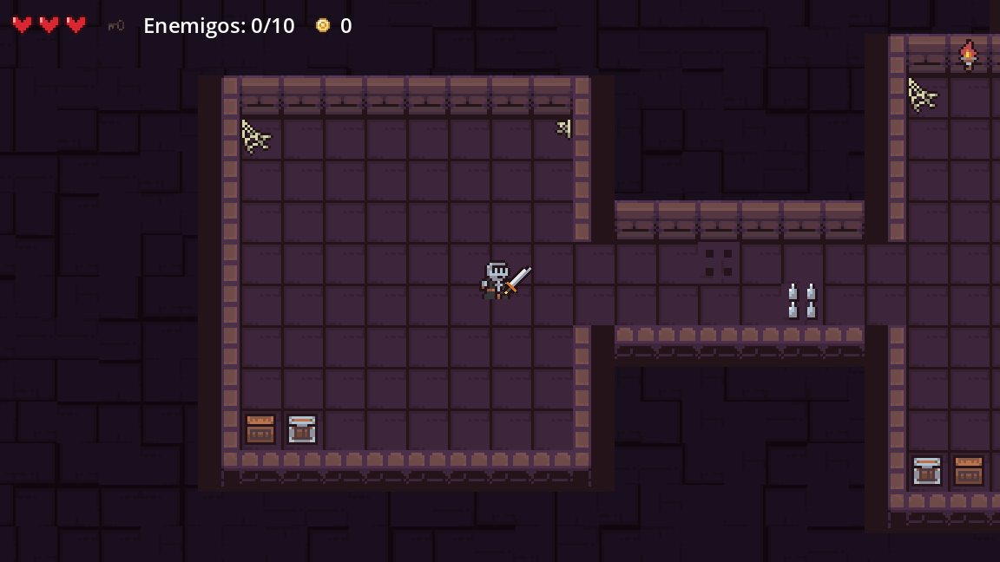
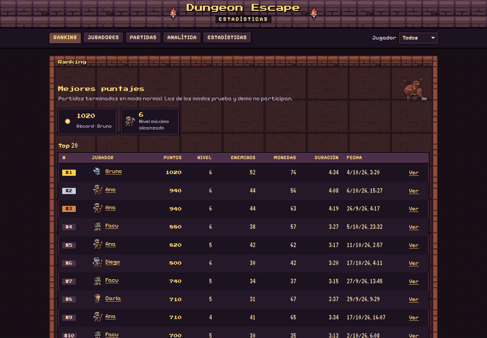
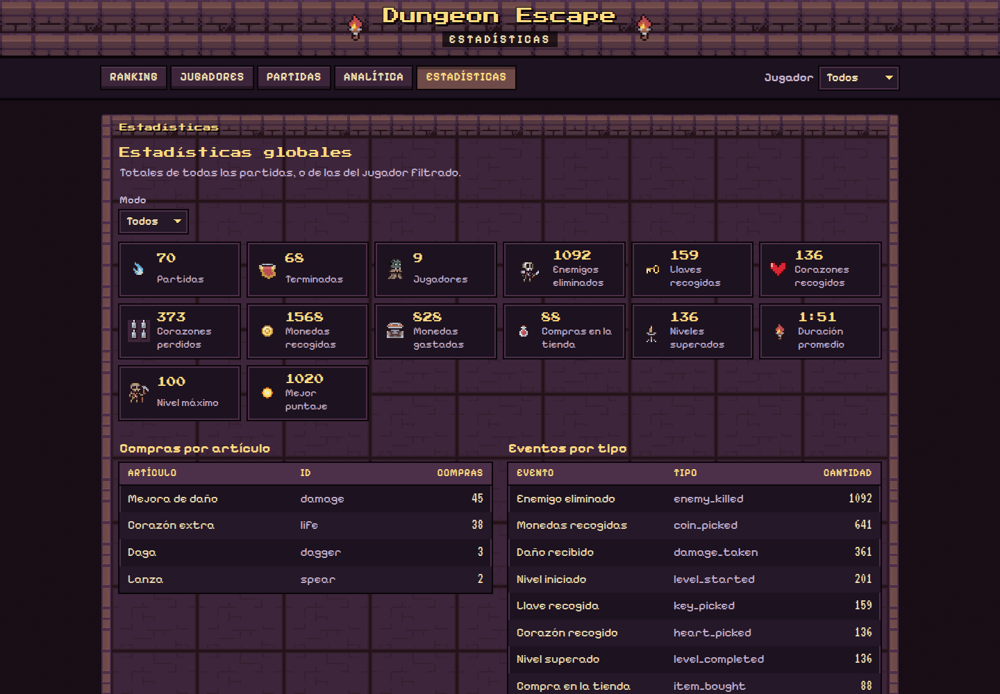
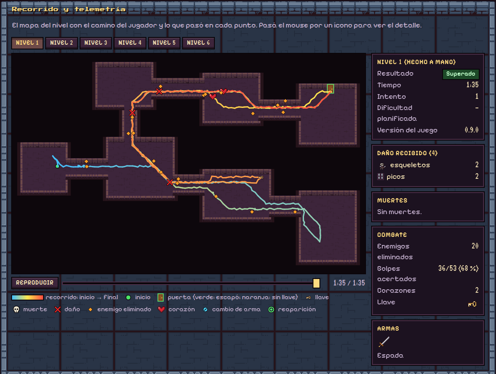

# Entrega: base de datos y sistema local de consulta

**Objetivo:** integrar una base de datos al videojuego y desarrollar un sistema local para consultar la información guardada, de modo que los jugadores tengan motivos para volver (ranking, récords, historial).

## Entregables

| Entregable | Dónde |
|---|---|
| Repositorio público | <https://github.com/Thegreenmarshadow/dungeon-escape> |
| Video corto | _(pegar aquí el enlace al video)_ |
| 3 capturas de pantalla (más una extra) | [`docs/capturas/`](capturas/) (se muestran abajo) |

## Requisitos y dónde se cumplen

| Actividad | Cómo lo resuelve el proyecto | Archivos |
|---|---|---|
| Conectar el juego con una base de datos | El juego envía cada partida por HTTP/JSON a un servidor local (FastAPI) que la guarda en SQLite. Si el servidor está apagado, la guarda en una cola en disco y la reenvía después. | `scripts/stats/`, `server/game_stats/`, `server/schema.sql` |
| Guardar todo lo que hace el jugador | Cada partida guarda tiempo jugado, nivel alcanzado, puntaje, enemigos eliminados y resultado. Cada acción es un evento con su momento en la partida: monedas y llaves recogidas, corazones, daño recibido, compras en la tienda, cambios de arma, muerte o abandono. Además, cada nivel sube su recorrido y su mapa. | tablas `players`, `runs`, `events`, `level_tracks` |
| Leaderboard | Tabla de mejores puntajes en el menú del juego y en la página web. Solo cuentan las partidas terminadas en modo normal. | `GET /api/leaderboard`, `scripts/stats/online_leaderboard.gd`, `server/web/js/ranking.js` |
| Interfaz web local | Página en <http://127.0.0.1:8765/> servida por el mismo servidor, con cinco secciones: Ranking, Jugadores, Partidas, Analítica y Estadísticas. | `server/web/` |

## Capturas

**1. El juego.** La interfaz muestra la vida, la llave, los enemigos eliminados y las monedas; todo eso se registra en la base.

**2. Leaderboard en la página web local.** Mejores puntajes con nivel, enemigos, monedas y duración de cada partida.

**3. Estadísticas guardadas.** Totales de partidas, enemigos, llaves, corazones, monedas recogidas y gastadas, compras y eventos por tipo.

**4. Extra: recorrido de un nivel.** El mapa con el camino que hizo el jugador, del inicio al final, y dónde recibió daño, eliminó enemigos y recogió corazones y la llave. Al costado: resultado, tiempo, daño por fuente, golpes acertados y arma usada.

> Las capturas web usan las partidas reales más las de ejemplo que agrega `uv run game-stats-seed` (jugadores como Ana o Bruno).

## Cómo probarlo

1. Encender el servidor: `cd server && uv run game-stats` (requiere [uv](https://docs.astral.sh/uv/)).
2. Jugar una partida (ejecutable de [Releases](https://github.com/Thegreenmarshadow/dungeon-escape/releases/latest) o el proyecto en Godot 4.7.2).
3. Abrir <http://127.0.0.1:8765/> y buscar la partida en **Partidas** y el puntaje en **Ranking**.

## Guion del video (1 a 2 minutos)

1. **Servidor (10 s):** ejecutar `uv run game-stats` y mostrar que arranca en el puerto 8765.
2. **Juego (40 s):** escribir el nombre en el menú, jugar un nivel recogiendo monedas, la llave y eliminando enemigos; morir o salir.
3. **Leaderboard en el juego (10 s):** volver al menú y mostrar el ranking con «Fuente: en línea».
4. **Página web (40 s):** abrir <http://127.0.0.1:8765/> y recorrer Ranking (la partida recién jugada), Partidas (su detalle con la línea de tiempo y el recorrido), Jugadores y Estadísticas.
5. **Base de datos (10 s, opcional):** mostrar `server/data/game.db` o la documentación de la API en <http://127.0.0.1:8765/docs>.
